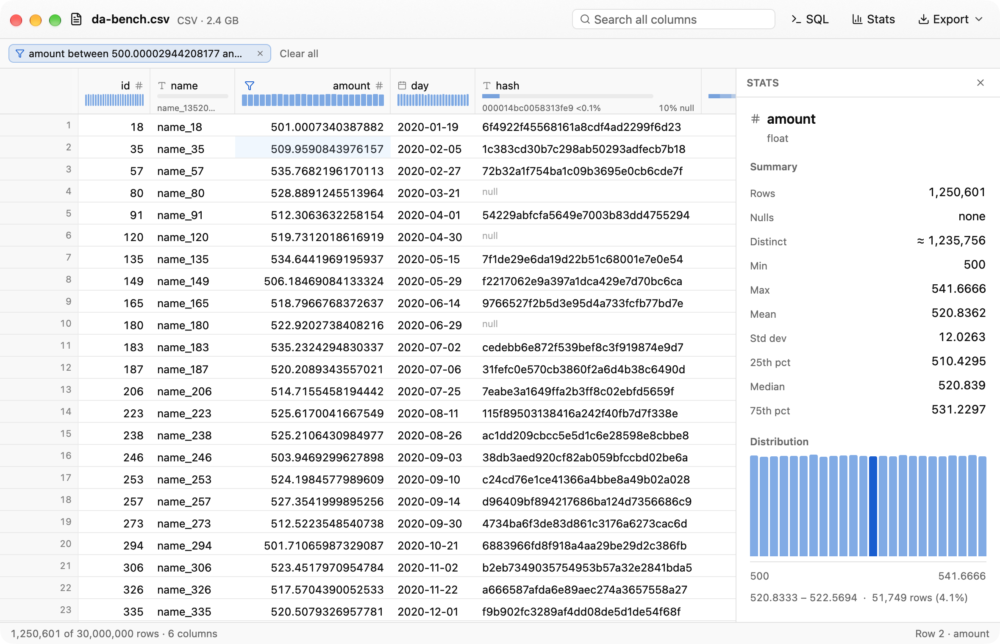

# Data Analyzer

A free, native macOS app for opening and exploring data files: CSV, TSV, Excel (xlsx/xls), Parquet and JSON/NDJSON. Double-click a file in Finder and you get a fast table with column stats, sorting, filtering, search and SQL. Multi-GB files open instantly and finish loading in seconds.



## Features
- **Instant preview, background load.** The first rows of a CSV/JSON file show up right away while the full file loads into DuckDB, with progress and a cancel button.
- **Virtualized grid** that scrolls through tens of millions of rows. Column headers show type, null % and a mini distribution.
- **Sort, filter, search.** Click headers to sort (shift-click for a secondary sort). Use column menus for filters and ⌘F to search every column.
- **Stats panel** (⌘I): summary stats, a histogram or top values, and click-to-filter.
- **SQL** (⌘E): the file is the table `data`, and results open in the same grid.
- **Export** the current view to CSV, Parquet or JSON Lines.
- **Excel sheets** as tabs. **Default app** for data files via *Data Analyzer → Make Default for Data Files…*

Measured on an M4 Pro with a 2.4 GB, 30M-row CSV (release build, warm disk): first rows in 170 ms, full load in 3.5 s, any page in about 4 ms, sort in 2.2 s, search in 1 s.

## Layout
- `crates/core` (`da-core`): the data engine. DuckDB for CSV/TSV/Parquet/JSON, calamine for Excel. No UI code.
- `crates/app` (`data-analyzer`): the GPUI interface, built with [gpui-kit](https://github.com/longbridge/gpui-kit).
- `packaging/Info.plist`, `scripts/bundle.sh`: app bundle, file associations, signing and notarization.

## Develop
```sh
cargo run -p data-analyzer -- path/to/file.csv   # use --release for big files
cargo test --workspace
cargo clippy --workspace --all-targets && cargo fmt --all
```

## Build the app
```sh
scripts/bundle.sh               # dist/Data Analyzer.app + DMG, signed with your Developer ID
scripts/bundle.sh --notarize    # also notarize + staple (needs a notarytool profile, see the script header)
```
