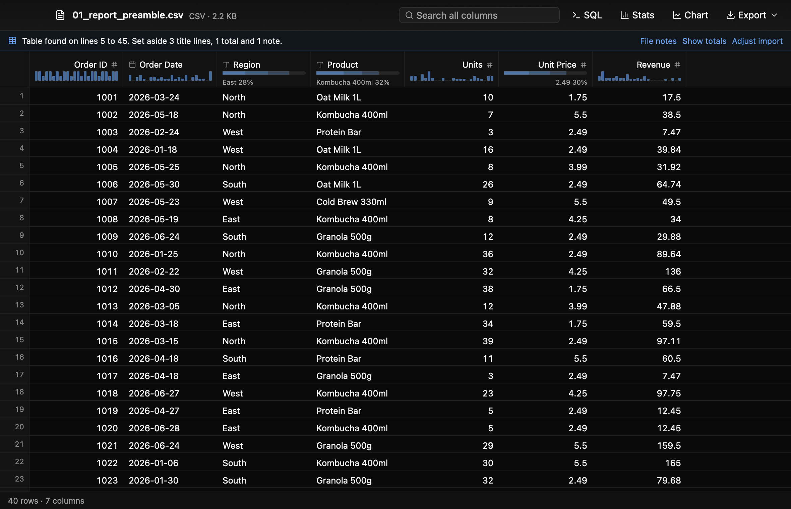
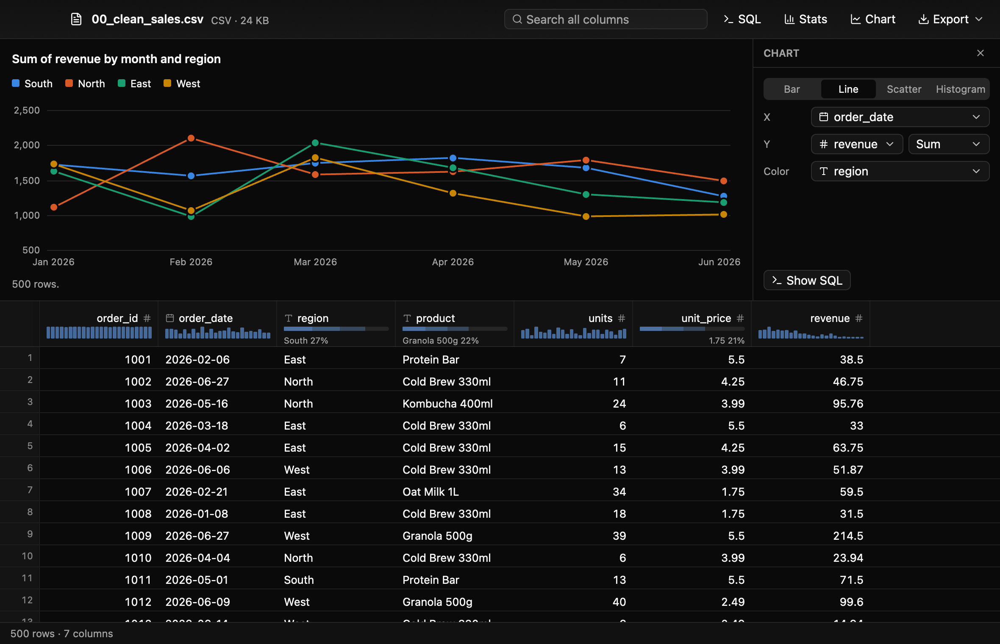

# Data Analyzer

A free, native macOS app for opening and exploring data files: CSV, TSV, Excel (xlsx/xls), Parquet and JSON/NDJSON. Double-click a file in Finder and you get a fast table with column stats, sorting, filtering, search and SQL. Multi-GB files open instantly and finish loading in seconds.






## Features
- **Instant preview, background load.** The first rows of a CSV/JSON file show up right away while the full file loads into DuckDB, with progress and a cancel button.
- **Virtualized grid** that scrolls through tens of millions of rows. Column headers show type, null % and a mini distribution.
- **Sort, filter, search.** Click headers to sort (shift-click for a secondary sort). Use column menus for filters and ⌘F to search every column.
- **Stats panel** (⌘I): summary stats, a histogram or top values, and click-to-filter.
- **SQL** (⌘E): the file is the table `data`, and results open in the same grid.
- **Chart panel** (⇧⌘C): bar, line, scatter or histogram of what the grid shows, picked from dropdowns, with click-to-filter.
- **Export** the current view to CSV, Parquet or JSON Lines.
- **Values read as written.** Text columns of `$1,234.00`, `12.6%`, `1.424,50`, mixed date spellings or Yes/No load as numbers, dates and booleans, shown the way the file wrote them; a column with one value that doesn't fit stays text. Files in Windows-1252 or UTF-16 open too.
- **Finds the table.** Titles, notes and totals rows around a table are set aside and kept under File notes; multi-row headers are joined; two tables in one file or sheet become two tabs. One line under the toolbar says what was done, and *Adjust import* corrects a wrong guess.
- **Nested data.** A JSON file that wraps its records opens as rows, and nested objects in JSON and Parquet open into columns like `customer.address.city`.
- **Excel sheets** as tabs. **Default app** for data files via *Data Analyzer → Make Default for Data Files…*

Measured on an M4 Pro with a 2.4 GB, 30M-row CSV (release build, warm disk): first rows in 170 ms, full load in 3.5 s, any page in about 4 ms, sort in 2.2 s, search in 1 s.

## Install
Download the DMG from the [Releases page](https://github.com/AritraBonTerra/data-analyzer/releases) and drag Data Analyzer to Applications (Apple Silicon only).
The app is not signed with an Apple Developer ID, so macOS blocks the first launch of a downloaded build: allow it once under System Settings, Privacy & Security.

## Layout
- `crates/core` (`da-core`): the data engine. DuckDB for CSV/TSV/Parquet/JSON, calamine for Excel. No UI code.
- `crates/app` (`data-analyzer`): the GPUI interface, built with [gpui-kit](https://github.com/longbridge/gpui-kit).
- `packaging/Info.plist`, `scripts/bundle.sh`: app bundle, file associations, signing and notarization.

## Develop
```sh
cargo run -p data-analyzer -- path/to/file.csv   # use --release for big files
cargo test --workspace
cargo clippy --workspace --all-targets && cargo fmt --all
```

Screenshots: `cargo test -p data-analyzer shots -- --ignored --nocapture` renders each
scenario in `crates/app/src/shots.rs` to a PNG offscreen (no window, no screen-recording
permission), into `target/shots` or `$DA_SHOTS_DIR`. `DA_SHOT=<name>` renders just one.
Add a scenario there to look at a UI change.

## Build the app
```sh
scripts/bundle.sh               # dist/Data Analyzer.app + DMG, signed with your Developer ID
scripts/bundle.sh --notarize    # also notarize + staple (needs a notarytool profile, see the script header)
```

## Releasing
Every pull request and every push to `main` runs format, lint and tests (`.github/workflows/ci.yml`).
To release:
1. Bump `version` in `crates/app/Cargo.toml` and merge it to `main`.
2. Tag `main`: `git switch main && git pull && git tag v0.2.1 && git push origin v0.2.1`. The tag must be `v` plus that version, on a commit that is in `main`.

`.github/workflows/release.yml` then checks, tests and builds the app on GitHub, and publishes a release with
notes generated from the merged pull requests, `Data-Analyzer-<version>.dmg` and `latest.json` (version,
download link, size, SHA-256 and update signature). The run is under the Actions tab and takes about 25 minutes.
If any step fails, nothing is published.

Trial run: push a tag like `v0.2.1-dryrun.1`. It runs every step but publishing, and the DMG and
`latest.json` appear as artifacts on the workflow run. Delete the tag afterwards
(`git tag -d v0.2.1-dryrun.1 && git push origin --delete v0.2.1-dryrun.1`).

Update key: each DMG is signed with an SSH key, and the signature goes in `latest.json`. The public half is `packaging/update-key.pub`;
the private half is the repo secret `UPDATE_SIGNING_KEY`. GitHub never shows a secret again, so keep a copy of the private key
somewhere safe. If it is lost, make a new pair;
installed apps then need one manual reinstall of a build that carries the new public key.
